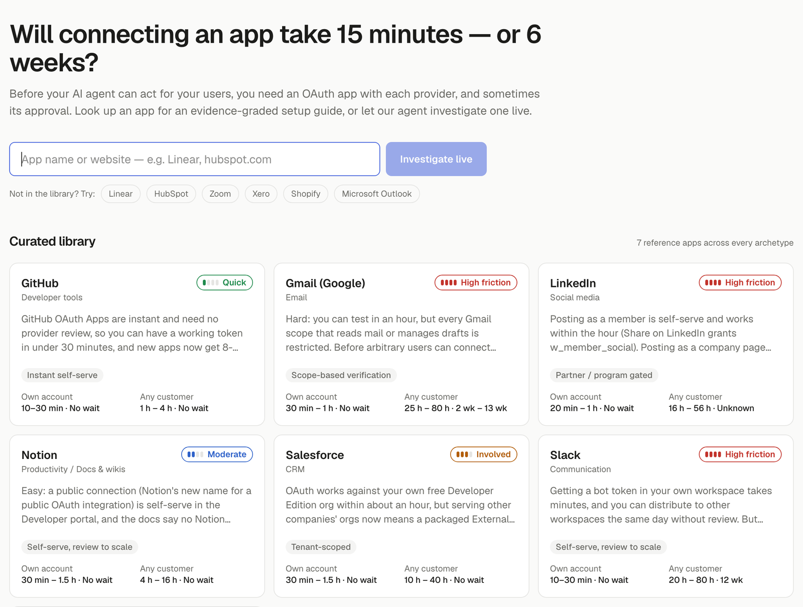
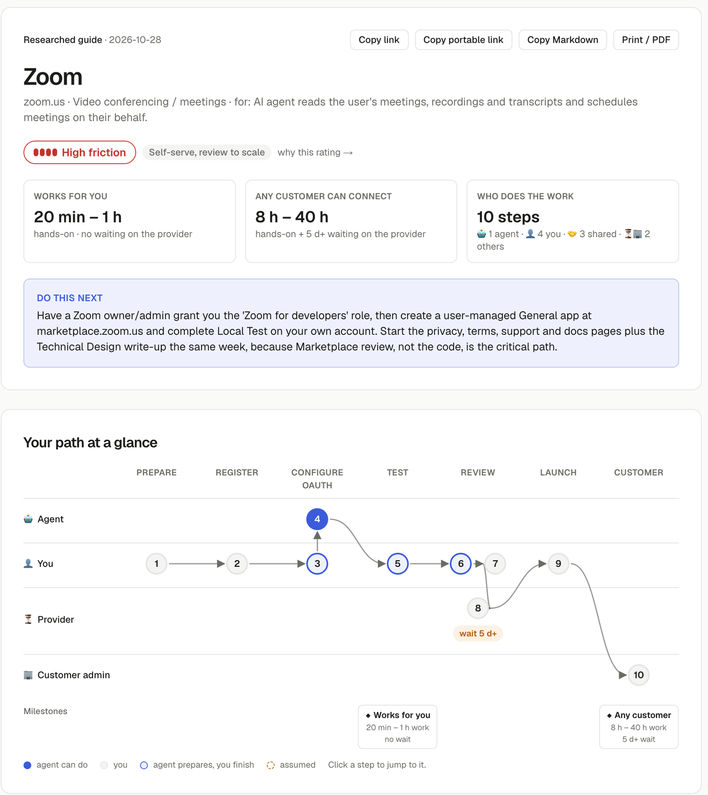

# OAuth Field Guide

Evidence-graded OAuth setup guides for AI-agent builders, and a live agent that investigates any app.

**Himanshu Gupta · Composio APM Integrations take-home**

Walkthrough: [Loom video](https://www.loom.com/share/717995e2d75449998b639e4912f94d39) · Live: https://oauth-field-guide-liart.vercel.app · Code: https://github.com/hmshuv/oauth-field-guide · Setup: [README](https://github.com/hmshuv/oauth-field-guide#readme)

To run the live agent on the hosted site, open **Settings** (top right) and paste a free Gemini API key from aistudio.google.com/apikey. The library and the example guides work without one.

## 1. The problem

When a developer's AI agent needs to act inside Gmail, Slack or Zoom, three separate things are involved, and they're easy to mix up:

- **The OAuth app.** Registered once by the developer with the provider: client ID, redirect URIs, scopes, branding, review status.
- **The integration.** The developer's code that runs the flow and calls the API.
- **The connection.** Each end user granting access, sometimes only after their own admin allows it.

Composio's managed-auth directory shows where the pain sits. For 124 toolkits Composio supplies the OAuth app; for 258 the developer has to bring their own. And even teams on a managed app eventually want their own name on the consent screen. Sooner or later, almost every agent builder has to set up and get approval for their own OAuth app.

> **Every provider has two clocks.** Getting OAuth working with your own account is nearly always a matter of minutes. Getting to the point where any customer can connect, with no user caps, warnings or throttling, can take weeks. That gap is where launches slip, and it's what the docs make hardest to see.

| | Works with your own account | Any customer can connect |
|---|---|---|
| GitHub | 10–30 min, no wait | 1–4 h, no wait |
| Slack | 10–30 min, no wait | 20–80 h, plus ~12 weeks of Marketplace review |
| Gmail | 30–60 min, no wait | 25–80 h, plus 2–13 weeks of verification and a security assessment |

Slack is my favourite example. You can distribute to other workspaces without any review, but since May 2025 apps outside the Marketplace are throttled to one history request per minute. An agent that reads channels effectively needs Marketplace approval, and nothing in the setup flow tells you that.

So the job isn't to summarise OAuth docs. For a specific app and use case, it's to answer: how hard is this, how long will it take including the wait, what could block me, what can an agent do for me and where do I take over, and what do I do next.

## 2. Scope, and why

I went deep rather than wide. The long-term goal is 100 apps; for this slice I built:

- **A library of 7 researched guides**, picked so every kind of friction is covered by a real app.
- **A live agent** that investigates any other app and writes a guide in the same format in a couple of minutes.
- **Two real live runs shipped as examples** (Linear, Plausible Analytics), so reviewers can see agent output without spending tokens.

Seven guides I trust, plus an investigator that produces the same format with the same rating rules and evidence checks, says more about the 100-app product than 100 thin pages would.

| App | Why it's in the library | Verdict |
|---|---|---|
| GitHub | Instant self-serve, but org owners must approve the app before an agent sees private repos | Quick |
| Notion | Self-serve; the user's page picker limits what the agent can see | Moderate |
| Salesforce | Each customer org's admin installs and controls the app | Involved |
| Slack | Works today; Marketplace approval decides your rate limits | High friction |
| Zoom | Even an unlisted app goes through full review; using meeting data to train AI is restricted | High friction |
| Gmail | Every mail-reading scope is restricted, which means an annual security assessment | High friction |
| LinkedIn | Posting as a member is self-serve; company pages need partner approval | High friction |

## 3. How I classify the problem

A single difficulty score hides the reason, and a flat list of requirements doesn't help anyone decide. So each guide has two layers:

- **One archetype**: what kind of gate sits between registration and production. Instant self-serve, self-serve with review to scale, scope-based verification, tenant-scoped, partner gated, or no public OAuth.
- **Friction flags** for the specific requirements that apply, 14 in total: paid plan, business or domain verification, policy URLs, manual review, demo video, security assessment, user cap before approval, partner application, customer-admin consent, per-customer setup, redirect rules, token quirks, optional marketplace.

The difficulty rating (Quick, Moderate, Involved, High friction) is computed in code from the archetype, the flags and the approval wait. The model never writes it, so a hand-researched guide and a live one are rated the same way. Two cases deliberately get no rating: **No public OAuth** (it isn't hard, it isn't available) and **Unrated** when less than 40% of a guide's claims are backed by evidence.

## 4. What a developer gets

Each guide reads in two passes, because that's how a developer uses it: first to act, then to understand.

- **Do it.** The verdict, the two clocks, who does the work, one next action, a map of the path, the blockers to watch for, a "before you start" checklist, the steps as a checklist, and copy-paste material: scopes, URLs and a prompt for your coding agent.
- **Why & details.** The reasoning behind each step and requirement, gotchas with fixes, why each scope is needed, reference facts, what was verified, and sources. Every item at the top links down to its explanation.

A few decisions worth calling out:

- **The path map.** Lanes for the agent, you, the provider's reviewers and your customer's admin, with arrows between steps and the provider's wait drawn in. It answers "what can an agent do and where do I take over" in one picture. It's drawn from the guide's data, so every guide, including live ones, gets one for free.
- **Agent or human, per step.** Each step says who owns it, why a human is needed when one is (2FA login, legal or billing, provider review, customer admin, DNS, recording a demo) and what an agent can do for it.
- **When the docs run out**, the guide says so and turns its open questions into a ready-to-send message to the provider.
- **Sharing.** A short link, a portable link that carries the whole guide in the URL (no database needed), Markdown and PDF.

## 5. The live agent

Type any app name or website and the agent:

1. checks the API key and model with a free metadata call, so a bad key never wastes a run;
2. identifies the app, its official domains and its docs;
3. if it isn't sure OAuth exists, runs one availability check first, and a "no" produces a short guide about the alternative instead of paying for full research;
4. researches the mechanics, the approval path and recent changes;
5. writes the guide as structured data in a separate step;
6. grades the evidence in code and probes the live OAuth endpoints;
7. saves it under a shareable link.

What I had to design for once it met reality:

- **Keys without search.** My Gemini key is free tier, and Google Search grounding returned 429 on every model. Rather than require billing, the agent falls back to reading the provider's own pages: the model suggests likely doc URLs, my code fetches them and follows OAuth-related links on official domains, and one call reads them. Every source in that mode is a page we actually retrieved, so it can't cite something that doesn't exist. The trade-off is that forums aren't searched, and each guide says so.
- **Free-tier limits.** The main model allowed 20 requests a day and was often overloaded, so calls walk a short chain of fallback models. Research is checkpointed, so a failure in the last step never pays for the research twice.
- **Cost.** A run is about 3 model calls (20–25k tokens) on the fallback path and 5 with search. Library guides, examples and repeat lookups cost nothing. Visitors can paste their own key; the shared key is rate limited per visitor.

## 6. Evidence: tested, sourced, uncertain

Every claim carries one of four labels: **Tested** (observed by our agent), **Source-backed** (official docs), **Community-reported**, or **Uncertain**. Code enforces them. A model can't mark anything as tested, source-backed needs an official citation, steps inferred from general OAuth practice are tagged as assumed, and URLs that never appeared in a source are flagged.

Attempting setup here means what an agent can honestly do without accounts: fetch each provider's discovery document, send a deliberately invalid client to the real authorize and token endpoints and record the response, and check that the console and docs URLs resolve. Across the library that's 34 of 34 probes passing, behind 335 graded claims.

I also checked the most surprising research claims against primary sources myself. All 8 held up, including GitHub's switch to expiring tokens by default, Slack's Marketplace rate limit, Gmail's restricted scopes and Salesforce's new 30-day idle limit on refresh tokens. Twice a secondary summary disagreed with the primary source; the guides follow the primary source and show the conflict as uncertain.

The probes also caught mistakes in my own logic:

- My first version "corrected" Slack's OAuth URLs to the ones in its discovery document. That document only covers Sign in with Slack, not bot installs, so the correction was wrong. A mismatch now only counts when the guide's own URL fails.
- GitHub answers an unknown client with a 404 instead of a standard OAuth error, which looked like a broken URL. The probe now judges the response body.

What stays uncertain: review timelines most providers don't publish (LinkedIn, Slack in practice), details that only exist behind a console login, and assessment costs that only come from community reports. The full log is in `docs/verification.md`.

## 7. How I worked

I ran this like a small product team, with coding agents as the engineers and me as the product lead.

- **Understand the brief first.** I broke the assignment down into an interactive page that maps every line of it to what it means in practice (`docs/process/assignment_breakdown.html`).
- **Write the rules before the code.** `principles.md` holds the product anchors: de-risk the launch, honesty over confidence, an explicit agent and human split, a focused slice. `project.md` is the work breakdown and `sprint.md` the plan, with a decision checkpoint at every fork. `agent.md` is the operating protocol for the agents: research first, propose options, wait for a decision, grade evidence, update the docs after every sprint.
- **Run it in sprints.** Sprint 0 was research and the taxonomy, 1 the schema and library, 2 the live agent, 3 the UI. Sprint 4 was real-world testing and what it exposed: missing-docs handling, the free-tier fallback, the path map, the "do it first" layout and deployment.
- **Use agents where they're strong.** I built with Claude Code. Separate research agents wrote the library guides in parallel against one shared schema, and every output had to pass a validator, then the probes, then my spot-checks. The calls at each checkpoint were mine; the agents did the research and the building.

## 8. Key decisions

| Decision | What I chose | Why |
|---|---|---|
| Unit of guidance | Two clocks: own account vs. any customer | That gap is where launches slip |
| Classification | Archetype + flags, difficulty computed in code | Explains why something is hard; ratings stay consistent |
| Evidence | Four labels per claim, enforced by code | Developers need to know what to trust |
| Attempting setup | Credential-free endpoint probes | Honest about what an agent can do without accounts |
| Live pipeline | Research and structured output as separate calls | Search plus structured output in one call is unreliable on current Gemini models |
| No search on the key | Read the provider's official pages directly | Works on free keys, including reviewers' |
| Missing docs | No-OAuth verdict, Unrated under 40% evidence, assumed steps, ask the provider | Say it plainly instead of filling gaps |
| Page layout | "Do it" first, "Why & details" second, path map at the top | How a developer actually reads a guide |
| Sharing | Short link, portable link, Markdown, PDF | No database needed |
| Scope | 7 deep guides plus the live agent | Trust over breadth |

## 9. Limitations and next steps

- No agent creates real OAuth apps or submits reviews, so anything that only exists inside a logged-in console is source-backed at best.
- On a free key the agent reads official pages only. Forum-reported gotchas need search, either billing on the Gemini project or a search API such as Tavily.
- Live guides on the hosted version sit in temporary storage. The portable link is the durable way to share them.
- The search-grounded path is tested offline; the live runs so far used the official-pages path.

Next I'd seed the full 100-app index from Composio's directory with on-demand generation for each entry, re-run the probes on a schedule to catch provider changes, let a guide switch between scope sets (Gmail with only `gmail.send` is a very different story), and add forum search for gotchas.
